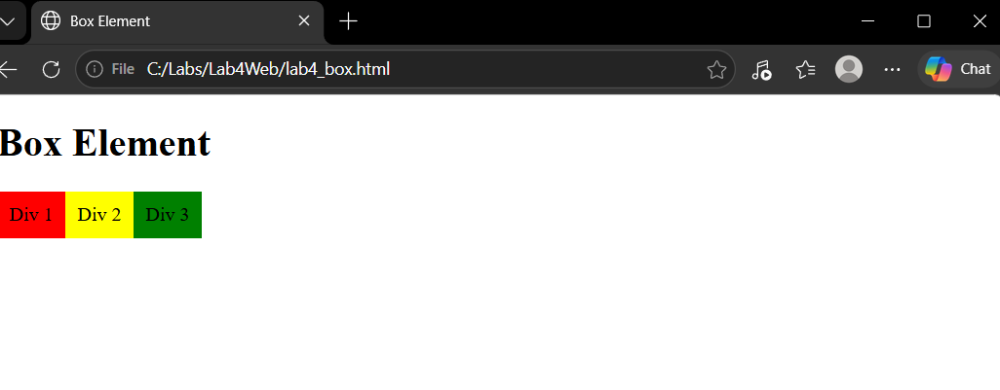
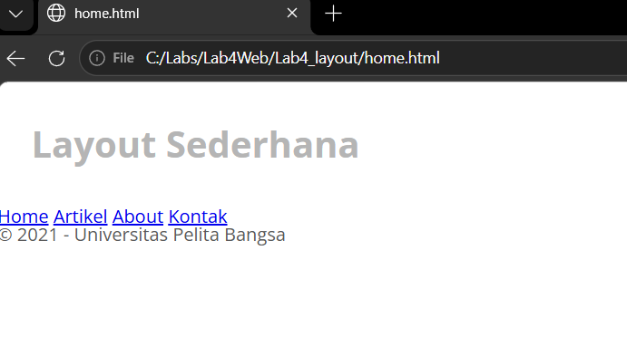
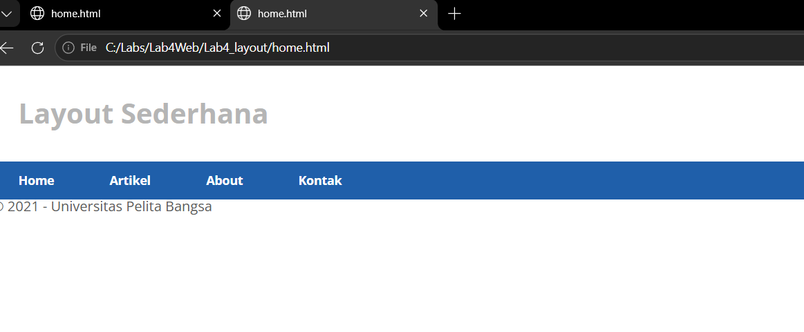
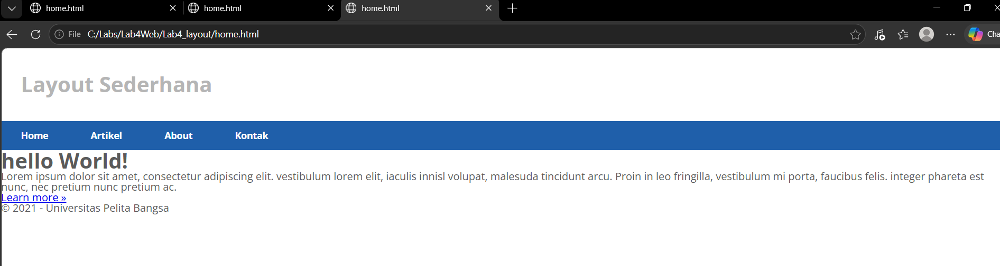
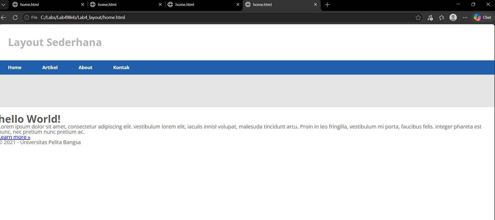
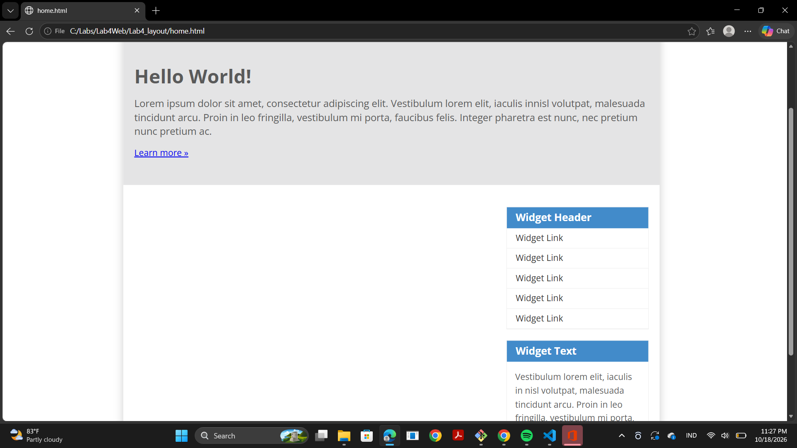
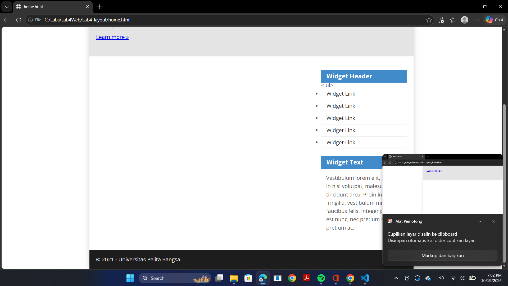
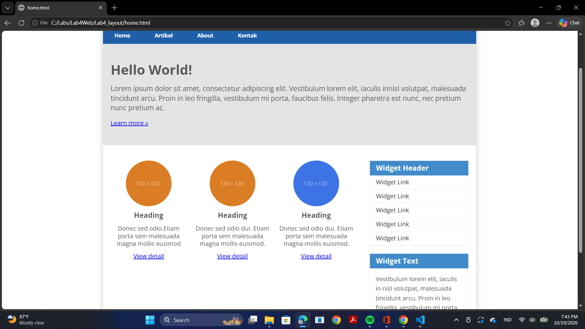
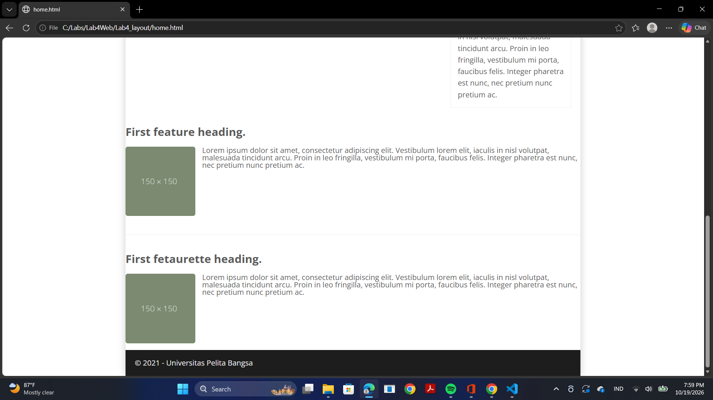

# Lab4Web
# praktikum css layout
# css layout
Ini adalah Hasil dari Tampilan Web Saya
MIftah Ma'ruf
312510032
# Menambahkan Foto

# Laporan Praktikum css layout

# Praktikum 4 - CSS Layout

## Langkah 1: Membuat Box Element
Membuat kotak menggunakan tag `
` dan memberikan warna berbeda menggunakan CSS.

## Langkah 2: Menggunakan Float
Menggunakan CSS `float: left` agar kotak tampil berdampingan.

## Langkah 3: Menggunakan Clear
Menggunakan CSS `clear: left` agar elemen berikutnya berada di bawah elemen yang menggunakan float.

## Langkah 4: Membuat Layout Website
Membuat file `home.html` dan `style.css` untuk menyusun layout website.

## Langkah 5: Membuat Navigasi
Membuat menu Home, Artikel, About, dan Kontak menggunakan HTML dan CSS.

## Langkah 6: Membuat Hero Panel
Menambahkan judul, teks, dan tombol pada bagian hero panel.

## Langkah 7: Membuat Main Content dan Sidebar
Membuat konten utama dan sidebar menggunakan CSS Float.

## Langkah 8: Membuat Footer
Menambahkan footer pada bagian bawah halaman website.

## Langkah 9: Menambahkan Konten Artikel
Menambahkan gambar, judul, dan paragraf pada bagian artikel.

## Langkah 10: Membuat Halaman About dan Contact
Membuat halaman About berisi deskripsi dan portofolio, serta halaman Contact berisi formulir nama, email, dan pesan.

## Kesimpulan
Praktikum ini membantu saya memahami cara membuat layout website sederhana menggunakan HTML dan CSS.
